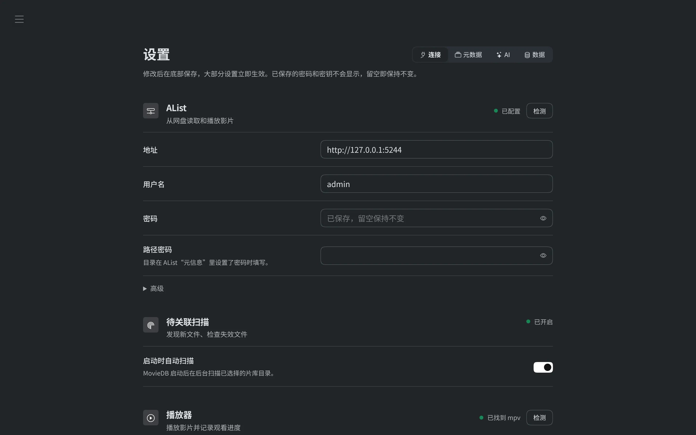

# MovieDB

**English** | [简体中文](README.zh-CN.md)

A self-hosted movie & TV library for videos stored on cloud drives. MovieDB reads your files through [AList](https://github.com/AlistGo/alist), fills in posters, cast and ratings from TMDB, recognizes messy release names (with optional AI help), and plays everything in your local player with resume support. It runs on Windows and macOS as a desktop app with a web UI.

> The user interface is in Simplified Chinese.


## Features

- **Library** — a home page with a “Latest additions” carousel, continue watching, unwatched and top-rated rows; browse by genre, year, rating and language; favorites and custom collections; light and dark themes.
- **Rich detail pages** — TMDB artwork, title logos, cast, overview; ratings from IMDb, Rotten Tomatoes, Metacritic, Letterboxd and Trakt; file details (4K, HDR10 / Dolby Vision, codecs, audio channels) read by ffprobe; season and episode browser.
- **Smart discovery** — scans the AList folders you choose, cleans up release names, matches them on TMDB and works out seasons and episodes. Uncertain names can go to an AI model (any OpenAI-compatible API; DeepSeek recommended). Results are grouped into *Ready*, *Review* and *Unrecognized*, and you confirm in bulk.
- **Link editor** — check every file against TMDB episodes, fix numbering with a visual filename-rule editor, handle per-folder seasons, continuous numbering and multiple versions of the same episode.
- **Local playback** — opens AList links in MPC-HC, IINA, mpv, VLC or the system default app; MPC-HC, IINA and mpv record progress and resume where you left off.
- **Desktop app** — Windows installer or portable zip, macOS `.dmg` for Apple silicon and Intel; bundles Python, all dependencies and ffprobe, and runs in its own native window (the system WebView2 / WKWebView — no bundled browser engine).
- **Guided setup** — a first-run walkthrough and a settings page that checks each service as you configure it.
- **Optional remote access** — reach the library through a Cloudflare Tunnel, with a read-only snapshot on Cloudflare Workers when your computer is offline.

| | |
|---|---|
|  |  |
| Movie details, ratings and file quality | Seasons, episodes and resume |
|  |  |
| Browse and filter the library | Smart discovery groups new files |
|  |  |
| Fix seasons and episodes with filename rules | Configure and check each service |

## Requirements

- **AList** (v3) with your cloud drives mounted. MovieDB can start a local AList for you.
- Posters and details come from TMDB. The installers ship with a built-in API key, so you don't need your own (you can still set one in Settings).
- Optional: an **MDBList** API key for extra ratings, an **AI** API key for smarter recognition, and a **video player** (MPC-HC on Windows, IINA on macOS, or mpv / VLC).

## Install

Download the latest version from [Releases](https://github.com/YUGOOD515/movie-db/releases).

### Windows

Run `MovieDB-Setup-<version>.exe`. It installs for the current user into `%LOCALAPPDATA%\Programs\MovieDB` without administrator rights. Start **MovieDB** from the Start menu or desktop; it opens in its own window using the Microsoft Edge WebView2 built into Windows (systems without it fall back to the browser). Closing the window keeps MovieDB running in the background so scans and sync carry on; the tray icon offers Open MovieDB, Settings, Open data folder, View log, Restart and Quit. Launching it again brings the existing window to the front.

Prefer no installer? Use `MovieDB-<version>-portable.zip`: unzip and run `MovieDB.cmd`. The portable version keeps its data next to the program, so you can carry the whole folder around.

### macOS

Download `MovieDB-<version>-macOS-arm64.dmg` (Apple silicon) or `-x86_64.dmg` (Intel); macOS 11 or later. Open the `.dmg` and drag MovieDB into **Applications**. MovieDB opens in its own window and stays in the Dock: closing the window keeps it running, clicking the Dock icon reopens it and ⌘Q quits. The MovieDB menu has Settings (⌘,), Open data folder, View log and Restart; the Go menu has Back / Forward (⌘[ / ⌘]).

The app is not signed with an Apple Developer ID, so the first launch is blocked. Open **System Settings → Privacy & Security** and click **Open Anyway** (needed once), or run:

```sh
xattr -dr com.apple.quarantine /Applications/MovieDB.app
```

### Updating

Install the new version over the old one. Your library and settings live in a separate data folder and are kept. Uninstalling removes the program only, unless you choose to delete the data as well.

## Getting started

MovieDB serves `http://127.0.0.1:5000` locally (if another program already uses port 5000 — on macOS usually the AirPlay Receiver — it moves to the first free port in 5050–5059 and remembers it) and shows it in its window (prefer the browser? Set *Interface* (界面打开方式) under **Settings → Connection → This computer** to the system browser, or `MOVIEDB_UI=browser`). On first launch a full-screen walkthrough connects everything, while a poster wall lights up as you go:


1. **Welcome** — checks whether AList is running, whether ffprobe works and where the library will be created, and connects to TMDB with the built-in key (falling back to the official `api.tmdb.org` domain when `api.themoviedb.org` is unreachable).
2. **Source · AList** — address and account. MovieDB checks the login, the visible storages and whether *Sign all* is enabled (needed for playback links). You can skip the check if AList isn't running yet. If TMDB is already reachable, setup finishes here.
3. **Posters & details · TMDB** (only when TMDB can't be reached) — set a proxy used for TMDB only, turn on the public image relay (wsrv.nl) if posters don't load, or enter your own TMDB key.
4. **Done** — an empty library is created and **Add a folder to scan** opens right away. The page also points to optional extras in Settings: **AI recognition** (Zhipu GLM-4.7-Flash is free; DeepSeek, SiliconFlow, Gemini, OpenRouter, OpenAI and others work too) and **MDBList** ratings.

Then open **Media management → Link** (媒体资源管理 → 关联) in the sidebar, add your AList folders and confirm what MovieDB found. See [Adding media](docs/en/adding-media.md) for the details.

## Configuration

Everything can be changed later in **Manage → Settings** (管理 → 设置), grouped into **Connection** (AList, scanning, player, ffprobe, cloud snapshot, port), **Metadata** (TMDB, MDBList, IMDb ratings), **AI** and **Data**. Each group shows its status and has a **Check** button; less common options are under **Advanced**. Saved passwords and keys are never shown again — leave a field empty to keep it.

Settings are stored in a `.env` file in the data folder and take effect immediately, except the port (`MOVIEDB_PORT`), which needs a restart (use **Restart MovieDB** in the settings page or tray menu). The full list of variables is in [Configuration](docs/en/configuration.md).

### Where your data lives

The library (`library.db`), recognition cache (`discovery.db`), settings (`.env`), posters, thumbnails, the IMDb ratings file and logs are all kept in the **data folder**. Use **Open data folder** in the tray / menu bar to find it.

| How you run MovieDB | Data folder |
|---|---|
| Windows installer | `%LOCALAPPDATA%\MovieDB` |
| macOS | `~/Library/Application Support/MovieDB` |
| Windows portable zip | the `app\` folder inside the unzipped directory |
| From source | the repository root |

Set the `MOVIEDB_DATA_DIR` environment variable to use another location. **Settings → Data** can wipe local data and return to the first-run walkthrough.

### Players

| Player | Platform | Watch progress |
|---|---|---|
| MPC-HC | Windows (default) | Recorded and resumed; enable the web interface in MPC-HC *Options → Web Interface* |
| IINA | macOS (default) | Recorded and resumed |
| mpv | All | Recorded and resumed (resume only on Windows) |
| VLC, system default app | All | Opens only, no progress |

Leave the player empty to pick the first one installed.

## Run from source

Requires Python 3.13+ and [uv](https://docs.astral.sh/uv/).

```sh
uv sync
uv run --with pystray --with pywebview python desktop.py   # native window + tray
uv run python desktop.py                  # console only, Ctrl+C to quit
uv run --with pytest python -m pytest -q  # tests
```

On macOS, install the tools with `brew install uv ffmpeg` and a player such as `brew install --cask iina`. Building installers, the project layout and other developer notes are in [Development](docs/en/development.md).

## Documentation

- [Adding media](docs/en/adding-media.md) — smart discovery, AI recognition, the link editor, manual entry, deleting titles
- [Configuration](docs/en/configuration.md) — settings, environment variables, players, rate limits
- [Remote access](docs/en/remote-access.md) — Cloudflare Tunnel and the read-only cloud snapshot
- [Development](docs/en/development.md) — running from source, tests, offline test API, building installers
- [Changelog](CHANGELOG.md) (Chinese)

## License

The author has not chosen a license for MovieDB's own code yet. Bundled third-party code and assets keep their original licenses (for example the libraries in `static/vendor/` and the LGPL build of ffprobe in the installers). Movie data and images come from [TMDB](https://www.themoviedb.org); this product uses the TMDB API but is not endorsed or certified by TMDB.
