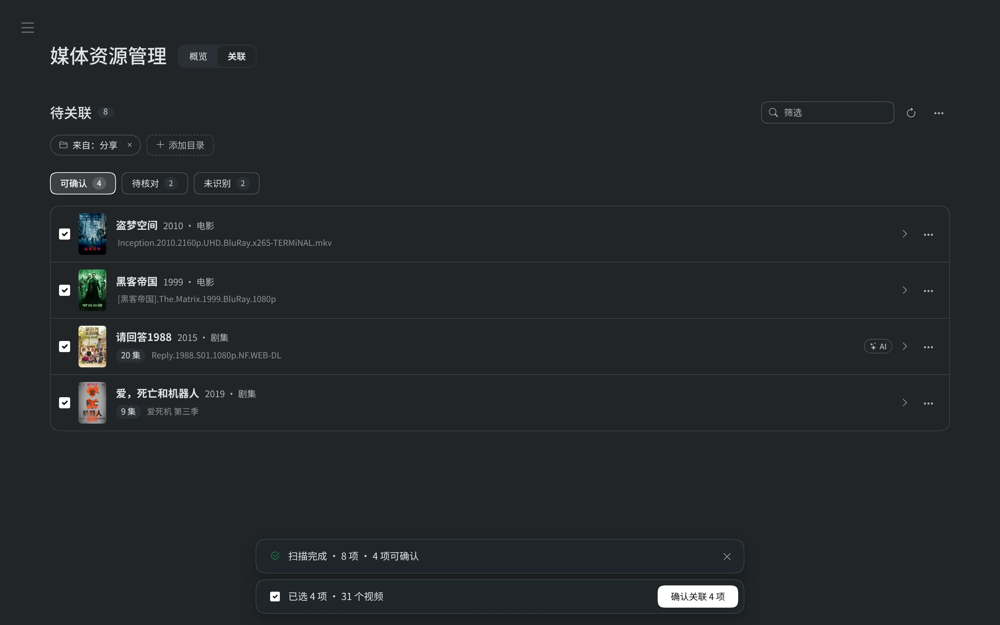
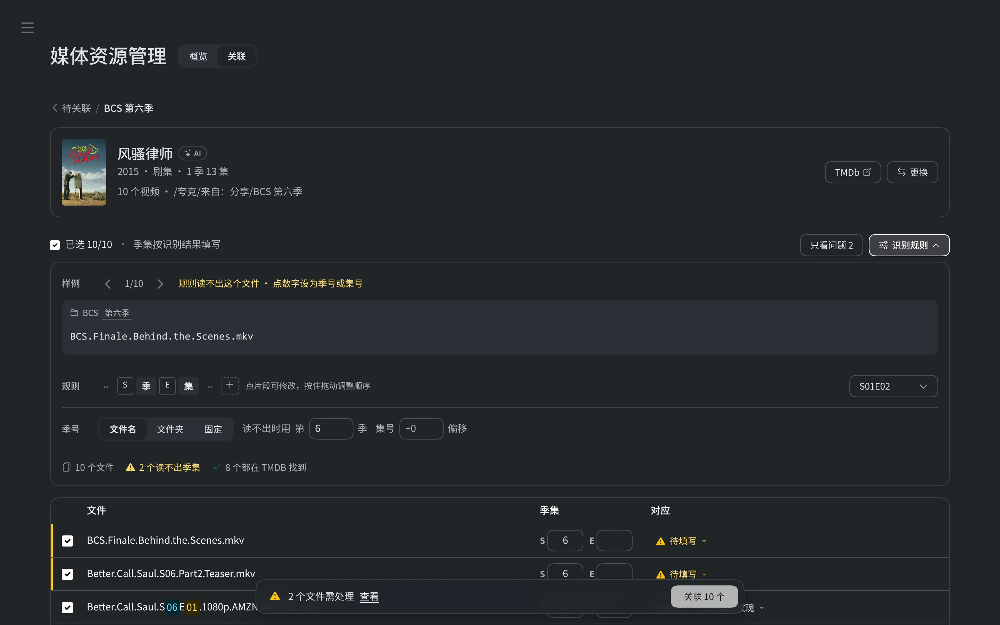

# Adding media

**English** | [简体中文](../zh-CN/adding-media.md)

There are three ways to add media: **smart discovery** scans your drive folders and proposes matches, the **link editor** lets you check every file against TMDB episodes, and **manual entry** takes an IMDb ID or a JSON file. All of them live under **Media management → Link** (媒体资源管理 → 关联) in the sidebar.

> The UI is in Chinese; labels are given in English with the original in parentheses where it helps.

- [Drives and credentials](#drives-and-credentials)
- [Smart discovery](#smart-discovery)
- [AI recognition](#ai-recognition)
- [Link editor](#link-editor)
- [Manual entry](#manual-entry)
- [Where metadata comes from](#where-metadata-comes-from)
- [How importing works](#how-importing-works)
- [Deleting a title](#deleting-a-title)

## Drives and credentials

Under **Media management → Link** (媒体资源管理 → 关联), use **+** in the left **Drives and linked folders** navigation to add a mount; the former Drives tab is now part of this workspace. Each connection shows its name and type on the first line and an optional account on the second. Healthy connections need no extra status; failures are highlighted in red. Click its name (right-click is also supported) to open connection details on the right, with configuration, status, checks and editing; enabling/disabling, passthrough switching and removal are in the **⋯** menu next to the details title. Saved credentials show only whether they are configured. The **+** menu at the top of the sidebar adds a drive or imports from AList. MovieDB only lists folders and reads playback files; it never uploads, renames or deletes drive content. Keep the mount name equal to the first segment of existing media paths.

- **Local folder** — enter an absolute path. Hidden files are skipped, and symlinks cannot escape the mount root.
- **QR login** (Quark, UC, Aliyun Drive, Baidu Netdisk, 115) — enter a mount name, click *Get QR code*, scan it with the drive's mobile app and confirm; the mount is saved once you are signed in, with no parameters to copy.
  - Quark / UC use the TV client API; Aliyun's official QR code is issued through the OpenList token service; Baidu uses its official device-code flow (you can also enter the user code at the address shown); 115 uses the official open-platform device code, and its tokens renew directly with 115.
  - One 115 open app can be signed in to the same account in at most 3 places; the oldest is signed out when that is exceeded. The AppID can be changed under Advanced.
- **User name and password** — 123 Cloud takes a phone number or email and password; WebDAV takes an address (for example `https://nas.local:5006/dav`), user name and password and works with Synology, Jianguoyun and similar servers (SharePoint mode is not supported yet).
- **Web authorization** (OneDrive, Google Drive) — click *Authorize* and sign in on the OpenList authorization page. In the desktop app OneDrive completes inside a MovieDB window and is saved automatically; Google does not allow sign-in from embedded windows, so it opens in the system browser and you paste back the final address starting with `api.oplist.org/#`. OneDrive regions such as 21Vianet are under Advanced.
- **Manual credentials** — every drive still accepts refresh tokens and other parameters under *Manual credentials*, for example from the [OpenList token tool](https://api.oplist.org/). Quark / UC also offer a "(Cookie)" type for a web cookie, and "123 Cloud (open platform)" takes developer credentials. 115 refresh tokens are single-use, so do not share the same token with another program.

Aliyun, Baidu, 123, OneDrive and Google Drive renew through `api.oplist.org` by default, a **third-party service run by the OpenList team**, not by MovieDB. Advanced settings allow custom credentials and renewal endpoints. New refresh/access tokens are stored only in the local `local.db` and never enter cloud snapshots.

**Automatic credential renewal** — while MovieDB runs it renews every drive's credentials on a schedule, starting once at launch. The session part of a Quark / UC cookie (`__puus`) expires after about 3 hours — listing still works but playback fails — so it is renewed every 100 minutes; Aliyun, Baidu and 123 are checked every 12 hours and their tokens replaced before they expire. The passthrough mount's connection is checked every 30 minutes. The Drives page shows the last renewal time; when renewal fails the status turns to “check failed” with the reason.

**Import from AList** — *Import from AList* on the Drives page reads the `data.db` in the AList / OpenList data folder (common locations are filled in automatically) or a JSON exported from *Backup & Restore*; the original file is never changed. The *Add a drive* step of first-run setup offers the same import. Each storage is listed with what will happen: Quark, UC (including the QR-login versions), Aliyun Drive Open, Baidu Netdisk, 115 Open, 123 Cloud (password and open platform), OneDrive, Google Drive, WebDAV and local storages create a mount, or update the credentials of a mount with the same name and take it back from passthrough; other drives, nested mount paths and disabled storages are skipped and stay on passthrough. Mount names follow the first segment of the AList mount path, so media already in the library keeps its links. Once every enabled AList storage has been imported you can stop the AList service and disable passthrough.

**Upgrading** — legacy AList settings in `.env` automatically create an **AList / OpenList (passthrough)** mount without changing the original values, so existing media keeps playing. You can move to a built-in driver later by reusing the same mount name. MovieDB no longer starts AList for you; keep the existing service running when using passthrough.

## Smart discovery

Use **Add folder** (添加目录) in connection details, or **⋯ → Manage scan folders** (管理扫描目录) in the association workspace to browse and add folders. If none is picked, MovieDB uses the shared folder it finds automatically. Below each connection, the sidebar lists only root folders explicitly chosen and saved by the user; it does not expand their descendants. Selecting a folder filters the right workspace. Clicking a connection opens its details: the line below the title shows status, type, account, mount path and renewal information, and the form below can be edited directly. Once something changes, **Discard / Check and save** (放弃 / 检测并保存) appear; discarding restores the original values and saving still checks the connection first. **View links** (查看关联) next to the scan folders filters the whole drive. Scope changes only filter the display, and batch confirmation includes only files in that scope. **Scan all folders** (扫描全部目录) rescans every configured folder, cleans up disguised file names, searches TMDB and works out seasons and episodes. Result tabs show counts and keep the selected tab:

- **Ready** (可确认) — confidence ≥ 0.8, and for series every file maps to exactly one TMDB episode. Several sources of the same title are merged into one expandable row. Rows are selected by default; the bottom bar shows how many items and videos are selected, and **Link N items** imports them in one go. Nothing is imported without your click.
- **Review** (待核对) — an inline tag explains why (for example “6/12 episodes matched”, “duplicate of a ready item”, “same-name titles exist”, “low confidence”). **Review** opens the [link editor](#link-editor) prefilled with the match.
- **Unrecognized** (未识别) — neither rules nor AI found a reliable match. Things that look like courses or software are tagged “probably not a video” and can be ignored one by one or all at once.
- **Linked** (已关联) — actual file mappings stored in the library, grouped by movie or series. **View mappings** (查看映射) shows files, seasons/episodes and targets in the selected scope, with a link to the title details. An offline drive or failed scan does not turn these records into pending items.

The source navigation stays available while reviewing or viewing mappings; returning preserves the scope, filter and list position. On phones, **Choose source** (选择来源) opens a drawer and file mappings stack vertically. Manual entry and JSON import remain in the right workspace's **⋯** menu.

Each row's **⋯** menu offers *Change title*, *Recognize again* and *Ignore*. Ignored items move to the **Ignored** tab and can be restored at any time; ignored folders are no longer expanded on later scans, so they cost no drive requests.

When a top-level folder contains no videos yet takes 10 seconds or more to scan (an e-book or software collection, for example), a note above the list names those folders and their total scan time after the scan finishes. **Skip from now on** (以后跳过) moves them to **Ignored**.

Nested category folders are first partitioned into works, retaining season and quality-folder context. Country-specific remakes, movie editions and series are checked separately. Recognition order: existing links in the library → folder names you confirmed before → same-name titles in the library → TMDB rule-based search → AI. Confirmed folder names are remembered. Cache signatures include folder contents, model configuration and recognition version; changing them triggers recognition again.

Each scan also checks files that are already linked. A file is marked **missing** only when the drive explicitly says it no longer exists (network errors don't count). The **Overview** tab can filter by missing files; nothing is deleted from your drive.

All of this is stored in `local.db` in the data folder (override with `MOVIEDB_LOCAL_DATABASE`) and is never included in the cloud snapshot. Once a drive is configured, MovieDB scans once at startup; turn this off in Settings or with `MOVIEDB_AUTOSCAN=0`.

## AI recognition

After you configure `LLM_BASE_URL`, `LLM_API_KEY` and `LLM_MODEL` (or pick a provider under **Settings → AI**), AI can refine groups in multi-work directories. It also helps when the rule score is below 0.75 or subsequent checks find conflicting titles, years or episodes. Scores are heuristic matches, not accuracy probabilities. AI candidates are still verified through TMDB/IMDb, with a maximum score of 0.9.

Inputs include directory context, relative-path samples from different branches and TMDB candidates. Read-only investigation is restricted to the current snapshot, TMDB searches and candidate detail/episode checks. Each phase permits at most three model calls and eight tool calls, and starts no new steps after 90 seconds. Every video must belong to exactly one group; validation errors are returned to AI for correction. Uncertain results retain the rule groups or require review; a series group the AI was unsure about can still become ready once every file maps to an episode of that title. This never moves drive files or imports automatically. Ignoring a directory also covers its descendants.

Directories clearly containing courses or stock footage remain non-media collections, with every file available for manual linking. **Recognize again** reassesses that label. If a work is identified but neither TMDB nor the local episode index provides unique IMDb IDs, the list explains why linking is unavailable; AI never invents episode IDs or repeatedly investigates this missing data.

### Pipeline

Each fully read directory enters recognition immediately while other directories continue scanning. Rules, AI and verification run **as a pipeline**: 16 threads run rule-based searches, uncertain folders are batched for AI, and another pool verifies answers and maps episodes. You can confirm recognized items while scanning continues. Incomplete directories remain available for review.

TMDB results are cached in `local.db` (searches 7 days, title summaries 30 days, titles without an IMDb ID 1 day), so re-recognizing after enabling AI, after a rule upgrade, or with *Recognize again* doesn't repeat the searches. When a folder's type is unclear, `/search/multi` finds movies and series in one request.

### Requests

- **Batching** — each request carries up to `LLM_BATCH_SIZE` items (8 for DeepSeek, 20 for others; a batch is sent when full or when its oldest item has waited 1 s). Input and output are JSON: `{"items":[{"id":"1","name":…,"samples":[…],"rules":[…]}]}` → `{"items":[{"id":"1","kind":"movie|tv|other","candidates":[…]}]}`. *Recognize again* on a single item uses the same format.
- **Cache-friendly prompts** — batches and single items share one fixed system prompt at the start of the request (`instructions` in the Responses API). DeepSeek's context cache matches on exact prefixes, and cached input costs about 1/50 of uncached input.
- **Retries** — truncated output and malformed JSON split the batch. Service and network failures retry the original batch up to three times, then stop further AI requests. Missing answers are batched for another request.
- **Circuit breaker and fallback** — an invalid key (401), insufficient balance (402) or bad parameters (400/422) stop AI requests for the current scan immediately. Rate limits (429/503) back off according to `Retry-After` and stop if they don't recover. Failed and skipped items fall back to rule results and are cached as “AI not used”, so the next scan retries them. The end-of-scan message lists the failure reason and count, plus request count, token usage and cache hit rate.
- **Protocol** — `LLM_API` selects `responses` (`/responses`) or `chat` (`/chat/completions`); both ask for JSON object output. On non-DeepSeek providers without JSON mode, MovieDB falls back to plain prompting.

**Check** in the settings page sends one tiny real JSON request, which catches problems such as an empty balance or a wrong model name.

### DeepSeek (recommended)

`LLM_BASE_URL=https://api.deepseek.com`, `LLM_MODEL=deepseek-flash`. Handled specially, following the official documentation:

- Uses the Responses API by default with thinking disabled (`reasoning.effort=none` for Responses, `thinking.type=disabled` for Chat; change with `LLM_THINKING`).
- DeepSeek has no per-minute limit, only a per-account concurrency limit (2500 for deepseek-flash, 500 for deepseek-v4-pro). MovieDB therefore keeps 64 requests in flight by default (`LLM_CONCURRENCY`, up to 500) and ignores `LLM_RPM`; on 429 it halves concurrency and ramps back up after consecutive successes.
- A trailing `/v1` from older configurations is removed automatically.

Request volume depends on batch size, directory complexity and investigation turns. `scripts/evaluate_recognition.py` replays a scan snapshot: by default it checks grouping only; `--live` uses the existing configuration for real recognition, saving results, investigation traces and token usage in an isolated directory without writing the production library.

## Link editor

Open a pending item to get the link editor:

- **Title card** — poster, year, type and season/episode count. **TMDb↗** opens the TMDB page for a quick check; **Change** searches for another title.
- **File table** — for series each row shows the season/episode and the matching TMDB episode. Rows with problems (missing number, no such episode, needs checking) are highlighted in yellow; **Only problems** filters them, and the *Episode* drop-down lets you pick one directly. Several files for the same episode are linked as versions.
- **Filename rules** — collapsed by default, opened automatically when some files have no readable season/episode or look like continuous numbering.
  - The sample file name is split into segments; click a number to make it the episode or season and a rule is generated (you can switch samples; unreadable files come first).
  - The rule is shown as one line of segments like `…S〔season〕E〔episode〕…`, highlighting the matching part of the sample on hover. The line is the editor: click a segment to change its type (season, episode, literal text, number…), edit literal text in place, move or delete segments, add one with **+** at the end, or drag to reorder (Alt + arrow keys also work). A missing episode segment is flagged in place. Common formats can be applied with one click.
  - The season can come from the file name, the folder name (such as “第二季” or “Season 2”) or a fixed value; with several folders you can set the season and an episode offset per folder. If every season folder starts at 01 but TMDB has only one season, MovieDB suggests continuous numbering and can shift it in one click (e.g. 01–06 in the second folder become episodes 7–12 of season 1).
  - The footer summarizes the file count, whether every season/episode was read and whether TMDB has them all; click an issue to jump to it.

The bottom bar is reserved for selection, validation and confirmation. **Link N** submits background jobs and returns to the list. After you confirm, the selected posters fly into a small orb next to the top-left menu button; open it from the home, detail or management pages and the tasks drop down as a column of cards with poster, status and progress. Click a title to expand its current progress: the four linking steps (check details, get links, read media info, write to library) and the episodes being processed. Failure reasons appear only when something fails, with retry and ignore; running tasks can be stopped. Queued titles stack as posters in the orb; finished ones slide out to the right and the next moves up. Failed or attention-needed ones stay, with an alert dot on the orb, until a later job links the same files to the same episodes, which clears the old failure automatically. Shared provider problems appear once with their recovery time; rate limits, busy services and exhausted budgets are distinguished. A title counts as linked once written to the library; artwork and ratings continue in the background without staying in the task list. Queued or deferred work does not display a fabricated percentage.

One notification summarizes the import round. **Clear completed** retains issues; individual results can be dismissed. Recent and unfinished jobs remain available across pages, and unfinished work resumes after an application restart. Titles run concurrently and episodes share the probe pool. A failed probe does not cancel other files: successful files are linked, and counts reflect the actual results, such as “5 episodes linked, 2 failed.” Each failure identifies its file. Use **Retry this file** (重试此文件) for one failure or the task's **Retry** action for the remaining failed files. Linked files are neither probed nor written again; files whose probe succeeded but whose write failed reuse their checkpoints. Optional-data retries also reuse checkpoints, even if a rescan has removed committed files from the pending list.

When a movie or episode has multiple files, its play menu compares duration, resolution, video codec, frame rate, dynamic range, audio codec and channels. Shared values appear once; compact pills show differences, missing values and durations to the second. Resolution uses familiar tiers through 8K, including 5K and 6K, with cropped widescreen sources retaining their tier. Ordinary parameters use Lucide icons and text; Dolby Vision, HDR, DTS and other special formats use NardBadges. The hero keeps its plain-text layout without pills. File size, container and source distinguish otherwise equivalent versions; choosing an option still starts playback directly.

The **Media versions** section shows every file and all its parameters directly, without an expand control. Desktop columns align the same fields across versions; mobile lists each version separately. Shared values remain visible, missing values say “Unknown,” and resolution includes the actual pixel dimensions. Paths, containers, pixel formats, bit rates, channel layouts and probe times are included in the same view. Borderless, transparent tables blend into the page. Click a filename or its trailing play icon to play that file; “Recently played” and “Default playback” describe how the playback file was chosen. Switching episodes updates all displayed versions.

## Manual entry

The **⋯** menu at the top right of the pending list has *Manual entry*, *Upload JSON* and *JSON template*.

- **By IMDb ID** — add a movie or an episode. A series ID needs a season and episode number; an episode ID resolves its parent series automatically. When TMDB omits an episode IMDb ID, the local official episode index fills it in; episodes still lacking a unique ID require review.
- **Search TMDB** — search by name → pick a movie or series → for a series, enter season, episode and a mounted path (`/mount/path`) per row (add or remove rows); for a movie, enter one path → add everything to the import list. Season and episode numbers are validated against TMDB on import. Adding only creates rows on the page and never overwrites existing data; the first addition replaces the single empty placeholder row. Finish with **Validate and import**.
- **Upload JSON** — bulk import following the template; if any entry fails, the whole batch is rolled back.

Searches and IMDb mappings are cached in memory for 10 minutes (up to 2048 entries) and identical concurrent requests are merged; the chosen match is reused on import. Cast and final artwork are fetched only on import, and candidate posters load in the browser on demand. If TMDB is unavailable you can still enter an IMDb ID; when an IMDb mapping or local data is missing, MovieDB tells you why.

## Where metadata comes from

- **TMDB** — title, year, genres, season/episode structure and episode IMDb IDs, overview, cast and images. Chinese titles fall back zh-CN → zh-TW → zh-HK; genres are converted to IMDb's English genres (e.g. Sci-Fi & Fantasy → Sci-Fi, Fantasy).
- **IMDb episode IDs** — from the local IMDb database (official `title.episode.tsv.gz`). It only fills missing episode IDs, preserving existing library relationships and TMDB links; TMDB remains the source for metadata and episode structure. Ambiguous positions are excluded. Unknown series IMDb IDs, episodes absent from TMDB and unreadable file episode numbers still require review. See [configuration](configuration.md#settings-page) for updates and [IMDb non-commercial datasets](https://data.imdb.com/non-commercial-datasets/) for the source and usage terms.
- **IMDb ratings** — from the same local IMDb database (official `title.ratings.tsv.gz`), updated together with episode IDs; every title and episode is updated when a new database is published. Titles added before the database exists get their IMDb rating once it is built. **Refresh ratings** on the Overview tab also re-reads it.
- **MDBList** (optional) — Rotten Tomatoes, Metacritic, Letterboxd, Trakt and more.

When you re-import an existing title, names, genres and season/episode relations already in the library are kept (only placeholder names like “Episode N” are replaced), and existing ratings are kept if new ones can't be fetched.

## How importing works

Confirmed jobs are scheduled by root IMDb title ID, with four titles preparing core associations by default. Committed titles continue enrichment in separate resource pools, freeing preparation slots. The total active window is four times the preparation concurrency, capped at 32 titles. Bounded process-wide pools prevent overlapping imports from multiplying concurrency. Each file gets a MovieDB `/stream` URL through `media_source` immediately before probing; expired links refresh once. Probe checkpoints survive restarts, while signed URLs and credentials are never stored in jobs.

After title and episode validation, association jobs commit each file separately. All steps within one file remain in a single transaction, and a failed write rolls back only that file. HTTP 5XX errors from ffprobe, including a 502 from MovieDB's local stream proxy, are reported as “Drive temporarily unavailable” and use the existing scheduled retries for up to three attempts. If failures persist, check the drive connection and retry the failed files. Missing files, permission issues and invalid formats have their own instructions. Artwork, scores, thumbnails and tones run alongside core linking, retrying unavailable services at their recovery time for up to three rounds. Images are processed as they arrive, shared actor photos download once, thumbnails and tones share a decode, and only selected episodes' images are prepared. IMDb ratings are read from the local database instead of decompressing the ratings file per title. Manual JSON imports retain their batch atomicity.

Jobs, probe checkpoints, request budgets and cached MDBList scores all live in `local.db` and are never included in cloud snapshots. Duplicate submissions reuse jobs; deleting a title cancels unfinished jobs before they can write it back. Resource pools and short write transactions are shared within the desktop application's process; a multi-process deployment needs a single import dispatcher. See [Configuration → Rate limits](configuration.md#rate-limits).

## Deleting a title

**Delete title** at the bottom of a detail page first shows exactly what will be removed: overview, ratings, every season and episode, local images and watch history. Images and cast photos can be scrolled sideways and are tagged *delete* or *shared, kept*; watch history shows the time, position and file length. The original videos on the drive and the collections themselves are kept. If the scope changes or more than five minutes pass, MovieDB checks again before deleting; afterwards you return to Media management with a confirmation.
