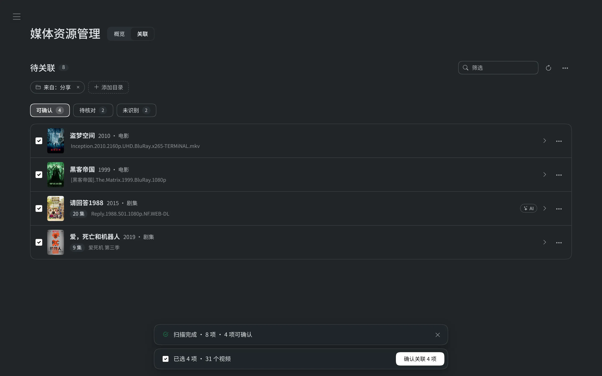
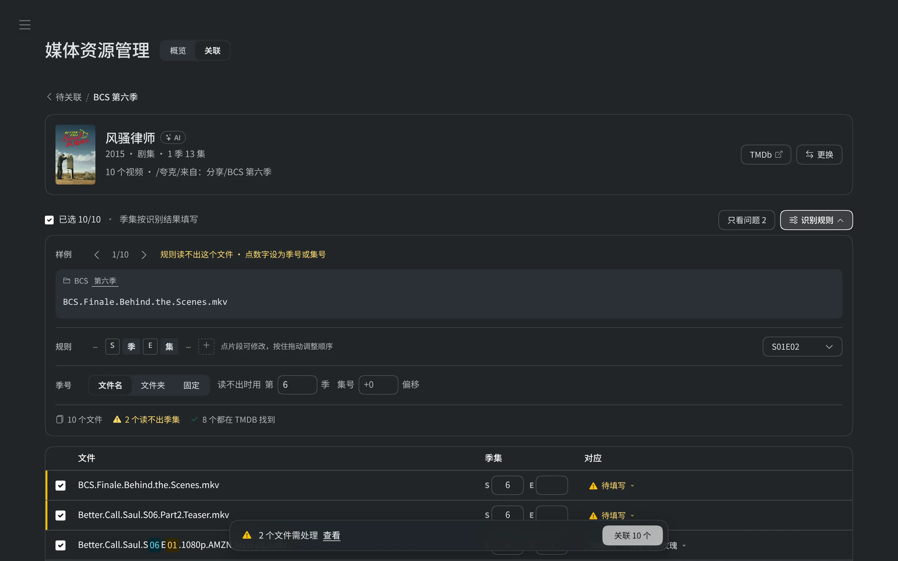

# 添加媒体

[English](../en/adding-media.md) | **简体中文**

MovieDB 有三种添加方式：**智能识别**自动扫描网盘目录并给出结果，**关联界面**逐个文件核对季集，**手动录入**直接填写 IMDb ID 或上传 JSON。入口都在侧栏“媒体资源管理 → 关联”。

- [网盘与凭据](#网盘与凭据)
- [智能识别待关联](#智能识别待关联)
- [AI 识别](#ai-识别)
- [关联界面](#关联界面)
- [手动录入](#手动录入)
- [元数据来源](#元数据来源)
- [导入过程](#导入过程)
- [删除作品](#删除作品)

## 网盘与凭据

在侧栏“管理 → 网盘”添加挂载。MovieDB 只列目录和读取播放文件，不上传、改名或删除网盘内容。挂载名必须与已有媒体路径的第一级目录一致；编辑时也可以直接修改挂载名。

- **本机目录**：填写要共享的绝对路径，隐藏文件不会扫描，符号链接不能逃出挂载目录。
- **夸克 / UC**：登录 `pan.quark.cn`（UC 为 `drive.uc.cn`），在浏览器开发者工具的网络面板中找到任意 `clouddrive` 请求，复制完整请求头 Cookie。
- **阿里云盘 Open**：打开 [OpenList Token 获取工具](https://api.oplist.org/)，选择阿里云盘 Open 或 TV，扫码后复制 refresh_token。可选择资源库或备份盘；高级设置也支持自己的 client_id / client_secret。
- **百度网盘**：在同一工具中选择百度网盘，授权后复制 refresh_token；也支持开发者自己的 client 凭据。
- **123 云盘 Open**：任选 refresh_token、开发者 client_id / client_secret，或约 90 天有效的 access_token 之一。refresh_token 可在上述工具取得。

阿里、百度和 123 默认通过 `api.oplist.org` 续期，这是 **OpenList 团队提供的第三方服务**，不是 MovieDB 自有服务；高级设置可改成自己的凭据或续期地址。新 refresh_token / access_token 会自动保存到本机 `local.db`，不会进入云端快照。

**老用户升级**：原 `.env` 中的 AList 配置会自动创建“AList / OpenList（透传）”挂载，原配置不改动，已有影片可继续播放。也可以改用内置驱动，只要保持原挂载名即可。MovieDB 不再代为启动 AList；使用透传时需要自行运行原有服务。

## 智能识别待关联

“待关联”页扫描你选定的网盘目录（点“+ 添加目录”浏览并添加；没有选择时沿用自动找到的“来自：分享”目录），在后台清洗伪装文件名、搜索 TMDB 并推测季集。结果按标签页分为三组，标签上显示数量，当前组处理完后自动切到下一组：

- **可确认**：置信度 ≥ 0.8，剧集的每个文件都对上 TMDB 中唯一的单集。同一作品的多个来源合并为一行，可展开查看。各行默认勾选，底部操作栏显示已选项数和视频数，点“确认关联 N 项”批量入库。仍需人工点击，不会自动入库。
- **待核对**：行内标签说明原因（如“6/12 集对上”“与可确认项重复”“有同名作品”“把握不大”），点“核对”打开已预填识别结果的[关联界面](#关联界面)。
- **未识别**：规则与 AI 都没有可靠结果；判断为非影视内容（课程、软件等）时标为“可能不是影视”，可逐项或在底部“全部忽略”。

每行的“⋯”菜单提供更换作品、重新识别和忽略。忽略的条目收在“已忽略”标签页，可随时恢复。

识别顺序：库内已有关联 → 曾确认过的同名目录 → 库内同名作品 → TMDB 规则搜索 → AI。确认关联后会记住原目录名，下次同名目录直接识别。识别结果按目录内容签名缓存，内容没变不会重复识别。

扫描时顺带检查已关联的文件：网盘明确返回不存在时才标记为“失效”，网络错误不改变状态；“概览”页可按“失效”筛选，源文件不会被删除。

这些数据保存在数据目录的 `local.db`（可用 `MOVIEDB_LOCAL_DATABASE` 指定位置），不进入云端快照。添加网盘后，应用启动时会自动扫描一次；可在设置页或用 `MOVIEDB_AUTOSCAN=0` 关闭。

## AI 识别

配置 `LLM_BASE_URL`、`LLM_API_KEY`、`LLM_MODEL`（或在设置页“AI”中选择平台）后，规则得分低于 0.75 的目录才会请求 AI。AI 给出的候选仍回到 TMDB 校验，置信度最高 0.9。

### 流水线

每个目录读取完整后就进入识别，不必等待其他目录扫描结束。规则、AI、核对三段**并行**：16 个线程跑规则识别（TMDB 搜索），拿不准的目录边产生边攒批交给 AI，另一组线程校验答案并推算季集。已识别的内容可立即确认关联，其余扫描与识别继续进行。读取不完整的目录保留为待核对。

TMDB 查询结果（搜索 7 天、作品摘要 30 天，暂无 IMDb ID 的 1 天）缓存在 `local.db`，配置 AI 后重新识别、规则升级或“重新识别”时不必再搜一遍；目录类型不明时用 `/search/multi` 一次搜电影和剧集。

### 请求方式

- **合并请求**：每次请求最多带 `LLM_BATCH_SIZE` 条（DeepSeek 默认 8，其他平台 20；批次凑满或最早一条等了 1 秒即发出），输入输出都是 JSON：`{"items":[{"id":"1","name":…,"samples":[…],"rules":[…]}]}` → `{"items":[{"id":"1","kind":"movie|tv|other","candidates":[…]}]}`。单条“重新识别”也用同一格式。
- **缓存友好**：批量与单条共用同一份固定的系统提示词，放在请求最前（Responses 的 `instructions`）；DeepSeek 上下文缓存按前缀完全匹配命中，命中部分价格约为未命中的 1/50。
- **自动重试**：输出被截断或 JSON 不完整时拆分批次；5xx、网络错误按原批次最多尝试三次，持续失败则停止后续 AI 请求；模型漏掉的条目合成一批补问。
- **熔断与降级**：Key 无效（401）、余额不足（402）、参数错误（400/422）立即停止本轮 AI 请求；限流（429/503）先按 `Retry-After` 退避，长时间不恢复则停止。失败与跳过的条目先用规则结果，缓存签名记为“未用 AI”，下次扫描自动重试；扫描结束的提示写明失败原因与条数，以及请求次数、token 用量和缓存命中率。
- **协议**：`LLM_API` 选择 `responses`（`/responses`）或 `chat`（`/chat/completions`），都要求 JSON 对象输出；非 DeepSeek 平台不支持 JSON 模式时自动退回纯提示。

设置页的“检测”会真实发送一次极小的 JSON 请求，能直接发现余额不足、模型名错误等问题。

### DeepSeek（推荐）

`LLM_BASE_URL=https://api.deepseek.com`、`LLM_MODEL=deepseek-flash`。按官方文档专门处理：

- 默认走 Responses API，关闭思考模式（Responses 用 `reasoning.effort=none`，Chat 用 `thinking.type=disabled`，可用 `LLM_THINKING` 修改）。
- 官方不限每分钟次数、只限账号并发（deepseek-flash 2500，deepseek-v4-pro 500），因此默认同时在途 64 个请求（`LLM_CONCURRENCY`，最多 500），忽略 `LLM_RPM`；遇到 429 并发自动减半，之后连续成功再逐步恢复。
- 旧配置里的 `/v1` 会自动去掉。

粗略估算：1000 个需要 AI 的目录约 50 次请求、输入约 20 万 token、输出约 8 万 token，按 deepseek-flash 价格约 0.1–0.2 美元（非高峰时段约减半）。

## 关联界面

点开待关联条目进入关联界面：

- **作品卡片**：显示海报、年份、类型和季集数；“TMDb↗”打开 TMDB 页面核对，“更换”重新搜索作品。
- **文件表**：剧集的每行显示季号 / 集号与对应的 TMDB 单集；问题行（待填写、无此集、需检查）以黄色标出，可点“只看问题”筛选，也可直接在“对应”下拉中选择单集。同一集的多个文件按多版本关联。
- **识别规则**：默认收起，有文件读不出季集或疑似连续编号时自动展开。
  - 样例文件名按段显示，点其中的数字设为集号或季号即可自动生成规则（可切换样例，优先显示读不出的文件）。
  - 规则以“…S〔季〕E〔集〕…”一行片段显示，悬停时与样例的对应部分联动高亮。这行片段本身就是编辑器：点片段可改类型（季号、集号、固定文字、数字等）、直接改固定文字、左右移动或删除，末尾“+”添加片段，按住片段可拖动排序（也可用 Alt + 左右方向键）；规则缺少集号时会就地提示。右侧可一键套用常用格式。
  - 季号可选从文件名、文件夹（如“第二季”“Season 2”）读取或固定，多个文件夹时可逐个设置季号和集号偏移。若各季文件夹各自从 01 编号而 TMDB 只有一季，会提示“可能是连续编号”，一键顺延（例如第二季文件夹的 01–06 对应第 1 季第 7–12 集）。
  - 面板底部汇总文件数、是否全部读出季集、TMDB 能否找到，点击问题项可定位。

底部只保留当前选择、校验和确认操作，没有问题后点“关联 N 个”提交后台任务并返回列表。打开侧栏中的“后台任务”，可在首页、详情页和管理页查看同一批任务。每部作品显示阶段、实际完成数和正在处理的季集；展开可看图片、评分、失败原因，并停止或重试任务。限流、服务繁忙和额度耗尽显示接口名称与恢复时间，多个作品遇到同一接口问题时集中提示。核心提交后标为“已关联”，补图和评分继续进行；排队与等待重试不显示虚假的进度百分比。

本轮关联结束后汇总通知一次；“清除已完成”保留需要处理的问题，单项可以主动收起。近期任务与未完成任务在切换页面后仍可查看，程序重启后会恢复未完成任务。重试已关联作品的补充资料时复用探测检查点，即使重新扫描后该文件已不在待关联列表中，也无需重复探测。多个作品并行处理，同一剧的多个文件共用探测池；服务端每个不超过 100 个文件的批次保持全有或全无，多批次之间独立提交。

同一电影或单集有多个版本时，详情页播放菜单按组比较时长、清晰度、视频编码、帧率、动态范围、音频编码和声道。相同参数只显示一次，各版本以紧凑胶囊展示差异数值，部分缺失写“未知”，时长精确到秒。清晰度统一为 8K、6K、5K、4K、2K、1080P、720P 或低清，裁切宽屏保留对应档位。常规参数用 Lucide 图标配文字；杜比视界、HDR、DTS 等品牌／特殊格式用 NardBadges。横幅维持文字排版，不加胶囊。参数相同时以文件大小、容器和来源辅助区分，点选版本仍直接播放。

详情页底部的“媒体版本”直接展示当前电影或所选单集全部文件的完整参数，无需展开。桌面按列对照，手机逐版本排列；字段保持相同顺序，公共值也完整保留，缺失值显示“未知”，分辨率同时显示常用档位和实际像素。文件路径、容器、像素格式、码率、声道布局与探测时间一并列出，表格不设分隔线，使用透明背景与页面衔接。点击各版本顶部的文件名或末尾的播放图标即可播放，“最近播放”与“默认播放”标记只表示播放选择依据。切换单集后同步展示该集的全部版本。

## 手动录入

“待关联”右上角的“⋯”菜单提供手动录入、上传 JSON 和 JSON 模板。

- **填写 IMDb ID**：可录入电影或单集。Series Title ID 需要同时提供季号和集号；Episode Title ID 会自动解析父剧集。TMDB 上没有 IMDb ID 的单集无法录入。
- **通过 TMDB 搜索添加**：输入名称搜索 → 选择电影或剧集 → 剧集按行填写季号、集号和挂载路径（`/挂载名/路径`，可增删多行），电影填写一条路径 → 全部添加到待导入列表。季号、集号导入时按 TMDB 季集校验。添加只生成页面记录，不覆盖已有内容；首次添加会替换唯一的全空占位行，最后统一点“校验并批量录入”。
- **上传 JSON**：按模板批量录入，任何一条失败整批回滚。

搜索与 IMDb 映射在进程内缓存 10 分钟（最多 2048 项），相同的并发请求会合并；选中的对应关系在导入时复用。演员和正式图片在导入时才获取，候选海报由浏览器按需加载。TMDB 不可用时可以直接填写 IMDb ID；缺少 IMDb 映射或本地数据时会提示原因。

## 元数据来源

- **TMDB**：标题、年份、分类、季集结构与单集 IMDb ID、简介、演员和图片。中文名按 zh-CN → zh-TW → zh-HK 回退；分类转换为 IMDb 的英文分类（如 Sci-Fi & Fantasy → Sci-Fi, Fantasy）。
- **IMDb 评分**：取自官方评分文件 `title.ratings.tsv.gz`（约 9 MB），首次录入时自动下载到数据目录的 `imdb/`，超过一天自动更新，可用 `IMDB_RATINGS_PATH` 指定位置。“概览”页的“刷新评分”用该文件更新全部作品与单集的 IMDb 评分。
- **MDBList**（可选）：烂番茄、Metacritic、Letterboxd、Trakt 等评分。

重新录入已有作品时，库内已有的名称、分类和季集关系保持不变（只替换“第 N 集”这类占位名），评分取不到时保留旧值。

## 导入过程

确认后的任务按根作品 IMDb ID 调度，默认同时准备 4 部作品的核心关联；已提交的作品在独立资源池继续补齐资料，不占用下一部作品的准备名额。活跃作品总数限制为准备并发的四倍（最多 32），避免积压过多上下文。不同作品及同一剧的多集共享有界资源池。文件拿到探测额度后才通过 `media_source` 取得 MovieDB `/stream` 地址并探测；过期链接重新获取一次，已完成的探测结果保存为恢复检查点。签名链接和令牌不写入任务记录。

必要元数据和视频探测完成后，核心关联即可提交。图片、评分、缩略图与色调同时推进，部分服务暂不可用时按恢复时间重试，最多三轮后提示未补齐。图片逐张处理，共用演员照片只下载一次；缩略图和色调复用一次解码，只准备本次关联单集的图片。IMDb 评分文件每次更新后生成本地 SQLite 索引，后续作品不再重复解压扫描。手动 JSON 导入仍保持整批原子性。

后台任务、探测检查点、请求预算和 MDBList 评分缓存都保存在 `local.db`，不进入云端快照。重复提交复用任务；删除作品会取消其未完成任务，防止稍后回写。当前桌面应用的资源池与短事务写入在同一进程内共享；多进程部署应使用单一导入调度进程。各服务预算见[配置 · 外部接口限速](configuration.md#外部接口限速)。

## 删除作品

详情页底部的“删除作品”会先检查并展示将要删除的内容：简介、评分、全部季集、本地图片和观看记录。图片与演员照片可横向浏览，以标签区分“删除”与“共用保留”；观看记录显示观看时间、播放位置与文件总时长。确认后执行，网盘上的原视频和收藏夹本身保留。确认范围有变化或超过五分钟时需要重新检查；删除成功后返回媒体资源管理页并显示提醒。
